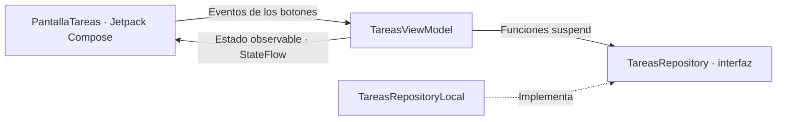
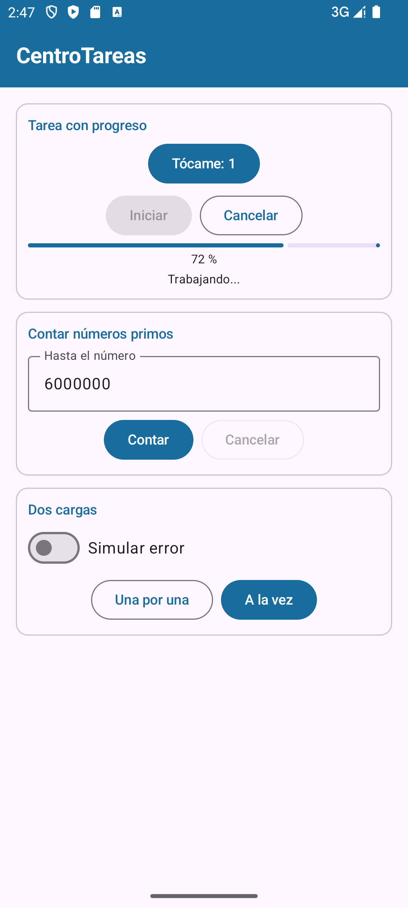
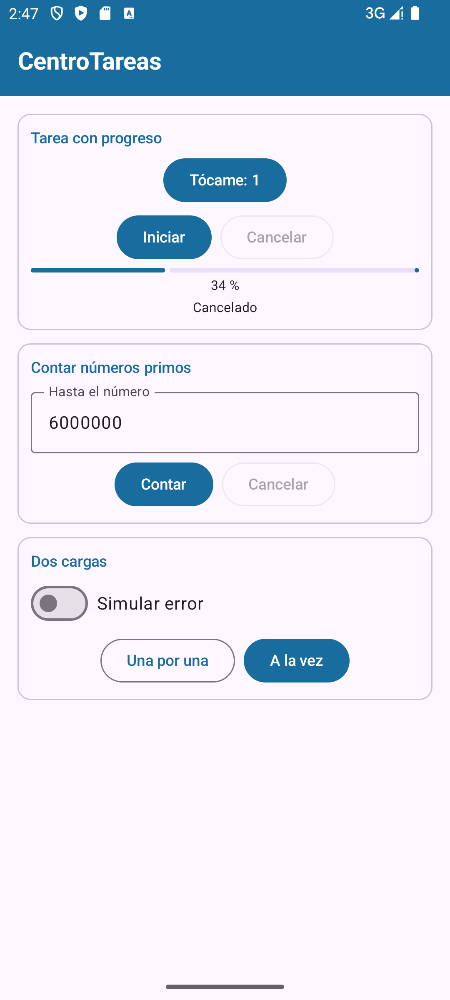
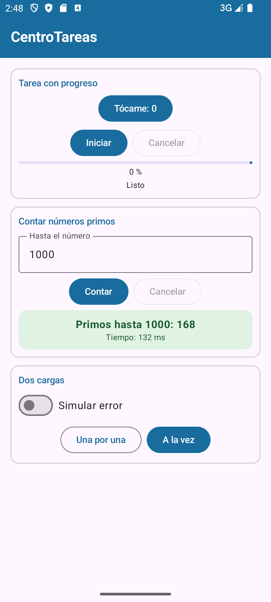
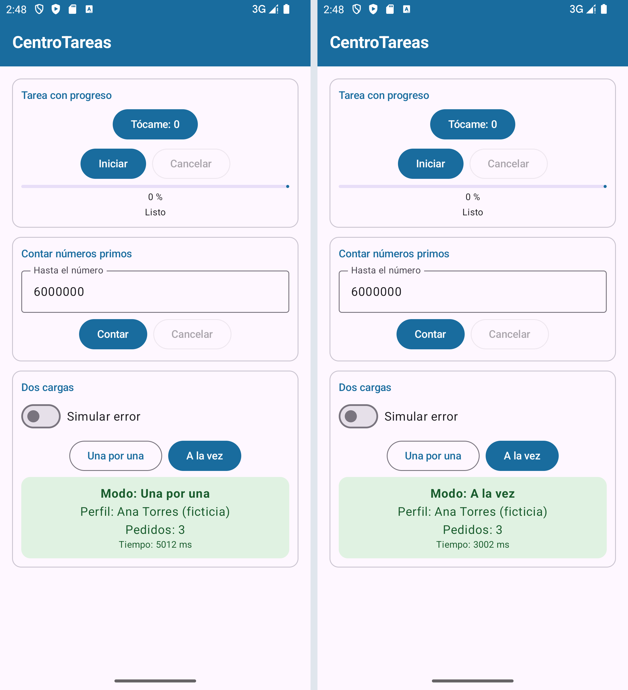
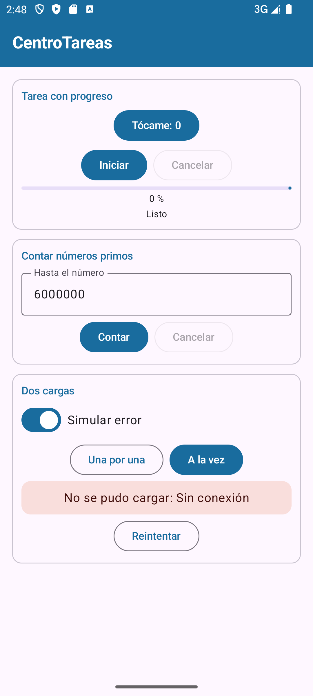

# CentroTareas

CentroTareas es una app Android de laboratorio que demuestra cómo mantener la
interfaz receptiva mientras una tarea avanza, se cuentan números primos o se
cargan datos ficticios. Permite comparar cargas secuenciales y paralelas, simular
un error y reintentar.

## Cómo ejecutarla

Abre el proyecto en Android Studio con el SDK de Android 35 instalado, sincroniza
Gradle y ejecuta el módulo `app` en un emulador o dispositivo Android. Las cargas
usan datos ficticios y funcionan sin conexión.

## Estructura

```text
com.garcia.centrotarea/
├── MainActivity.kt
├── data/
│   ├── TareasRepository.kt
│   └── TareasRepositoryLocal.kt
├── model/
│   └── Estados.kt
├── ui/
│   ├── PantallaTareas.kt
│   └── theme/
│       └── Theme.kt
└── viewmodel/
    ├── TareasViewModel.kt
    └── TareasViewModelFactory.kt
```

## Arquitectura MVVM



## Observación del Paso 1

Al pulsar **Tarea larga (MAL)**, la pantalla deja de responder durante unos cuatro
segundos y el contador **Tócame** deja de actualizarse durante la espera.
`Thread.sleep(4000)` ocupa el hilo principal, que se encarga tanto de atender
los toques como de dibujar la interfaz.

El ViewModel asigna **Trabajando...**, pero Compose no puede dibujar ese estado
mientras el hilo principal está bloqueado. Cuando se libera, el mensaje vigente
ya es **Terminó**.

Si la espera durara diez segundos y Android detectara eventos de entrada sin
atender a tiempo, podría mostrar el aviso de que la aplicación no responde
(ANR).

## Pruebas de aceptación

| Prueba | Resultado observado |
| --- | --- |
| Tocar **Tócame** durante la tarea | El contador siguió sumando. |
| Revisar Logcat con el filtro `HILO` | `main` antes y después, y `DefaultDispatcher-worker` dentro. |
| Iniciar la tarea con progreso | La barra llegó de 0 % a 100 % en 4,66 s. |
| Cancelar a mitad de la tarea | La barra quedó en 34 %, apareció **Cancelado** y se pudo iniciar otra vez. |
| Pulsar **Iniciar** dos veces seguidas | Se ejecutó una sola tarea. |
| Contar primos hasta 1000 | El resultado fue 168. |
| Contar primos con un límite grande | **Tócame** siguió respondiendo y el cálculo se pudo cancelar. |
| Cargar **Una por una** | Perfil ficticio y 3 pedidos en 5 012 ms. |
| Cargar **A la vez** | El mismo perfil y 3 pedidos en 3 002 ms. |
| Simular un error y pulsar **Reintentar** | Apareció el recuadro rojo. Con la simulación desactivada, el reintento recuperó los datos. |
| Rotar mientras la tarea avanza | En horizontal, la tarea seguía activa al 52 % y terminó al 100 %. |
| Revisar el código final | `git grep` no encontró `GlobalScope`, `runBlocking` ni `Thread.sleep` en los archivos Kotlin o Gradle. |

## Capturas

| Progreso | Tarea cancelada | Conteo de primos |
| --- | --- | --- |
| [](capturas/01-progreso.png) | [](capturas/02-cancelada.png) | [](capturas/03-primos.png) |

**Carga secuencial y carga en paralelo**

[](capturas/04-cargas-comparadas.png)

**Error simulado**

[](capturas/05-error.png)

## Para pensar

1. **¿Por qué no se veía Trabajando… en el Paso 1?** El ViewModel actualizaba el
   estado, pero `Thread.sleep` impedía que el hilo principal atendiera los eventos
   y dibujara el siguiente fotograma. Al liberarse el hilo, el estado ya era
   **Terminó**.
2. **¿Qué diferencia hay entre `Thread.sleep` y `delay`?** `Thread.sleep` bloquea el
   hilo que lo llama. `delay` suspende la corrutina, libera el hilo para otras
   tareas y responde a la cancelación.
3. **¿Por qué usar `Dispatchers.Default` para los primos y `Dispatchers.IO` para
   la red?** El conteo usa CPU, por lo que corresponde a `Default`. Las llamadas
   bloqueantes de red esperan entrada y salida, por lo que corresponden a `IO`.
   Aquí las cargas se simulan con `delay`, que suspende sin bloquear el hilo.
4. **¿Qué pasa si el usuario cierra la pantalla?** Cuando se elimina el ViewModel,
   `viewModelScope` cancela sus corrutinas. Al rotar, la actividad se recrea y
   conserva el ViewModel, así que la tarea y su estado siguen disponibles.
5. **¿Por qué `async` tarda 3 s y qué pasa si falla una carga?** En paralelo se
   inicia el perfil de 2 s junto con los pedidos de 3 s. El total se aproxima al
   tiempo de la operación más lenta. Si una falla con una excepción, el
   `coroutineScope` cancela la otra si sigue activa y propaga el fallo al
   ViewModel, que muestra el error. Una cancelación se vuelve a propagar.
